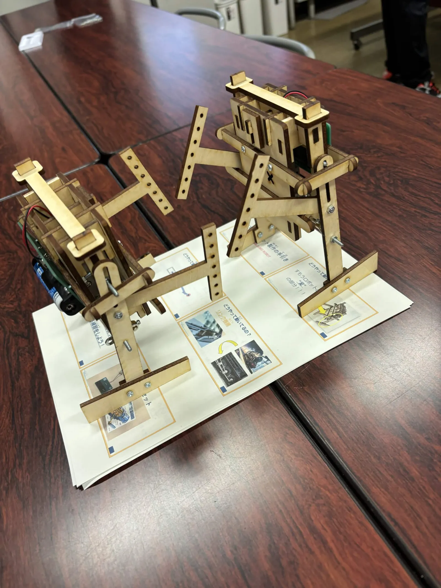

8月23日に本厚木駅前の厚木市子ども科学館さんにて、工作教室を開催させていただきました。

ご来場いただいた皆様、ありがとうございました！

今回、工作したのは「相撲ロボット」です。その名の通り、相撲を行うことができます。写真で分かる通り、体の大きな力士を彷彿とさせる見た目ですね。二本のアームが前に突き出すように動くことで、他の相撲ロボットを押し倒します。

子供たちは事前に切り分けられた木製のパーツを、ねじやドライバーといった工具を利用して組み立てていました。ときには、親御さんの手も借りながら、参加した全員が完成させることができました。

余った時間では実際に相撲が行われました。自分の作ったものが動いている様を見て、子どもたちは嬉しそうな表情を浮かべていました。

我々は他にも、子どもたちが喜んでくれるような活動をしています。ぜひ、またの機会にお越しください。
